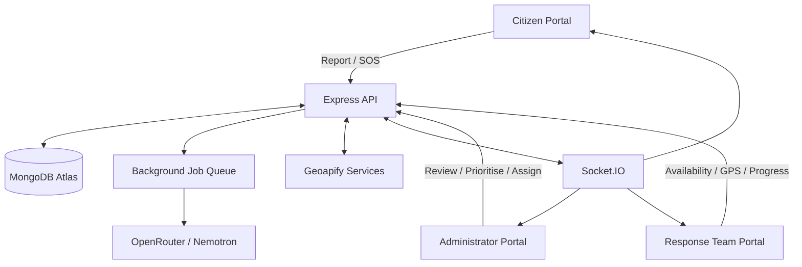

# 🚨 Emergency Response & Disaster Management Platform

> **A real-time emergency reporting, incident prioritisation, and response-team coordination platform connecting citizens, administrators, and emergency response teams.**


---

## 🧭 Repository Layout: Frontend + Backend Monorepo

This repository contains **both application projects in one Git repository**. The root directory is the shared repository root; `frontend/` and `backend/` are separate Node.js applications with their own `package.json`, dependencies, environment files, and development commands.

```text
repository-root/
├── frontend/       # React + Vite application
│   ├── src/
│   ├── package.json
│   ├── package-lock.json  # if generated/used by npm
│   └── .env.example
├── backend/        # Express API and background processing
│   ├── src/
│   ├── tests/
│   ├── package.json
│   ├── package-lock.json  # if generated/used by npm
│   └── .env.example
├── README.md       # Shared documentation for both applications
└── .gitignore      # Shared ignore rules for both applications
```

**Package-management note:** This is a monorepo by repository structure, but the frontend and backend are maintained as separate npm projects. Unless a root-level npm workspace is added to the project, run `npm install` and the relevant npm scripts **inside the corresponding subfolder**. Do not run frontend commands from `backend/`, or backend commands from `frontend/`. Keep both `package-lock.json` files under version control when they exist.

---

## 📌 Problem Statement

During emergencies such as fires, road accidents, floods, building collapses, and medical incidents, response depends on how quickly reliable information reaches the people coordinating assistance. Traditional reporting and coordination often involve disconnected phone calls, manual records, and limited visibility into the location and availability of response teams.

This creates several operational challenges:

1. **Delayed incident reporting and visibility:** Emergency details may reach administrators through fragmented channels, making it difficult to maintain one current incident record and communicate status changes to the reporting citizen.
2. **Limited response-team availability information:** Administrators may not know which medical, police, or fire-and-rescue teams are on duty, where they are currently located, or whether they are already assigned to another incident.
3. **Manual team selection and coordination:** Choosing suitable nearby teams and coordinating multiple services for one incident can take time, particularly when an incident requires medical, police, and fire support together.
4. **Unstructured incident information:** Incomplete, inconsistent, or potentially duplicate reports can make triage harder. Administrators need useful supporting information without treating automated assessments as proof.
5. **Limited end-to-end progress visibility:** Citizens may not know whether a team has been assigned, while administrators need a consolidated view of incident and response-team progress.

The **Emergency Response & Disaster Management Platform** is designed to bring these activities into one web application. Citizens can submit incidents and SOS alerts; administrators can review, prioritise, and coordinate incidents; and registered response teams can manage availability, share their location while on duty, receive assignments, and report progress.

The platform is a coordination and decision-support application. It does not replace official emergency dispatch services or guarantee that an emergency service has been contacted.

---

## 🚀 Features

The status column reflects the latest implementation report. Core response-team workflows have now been connected across the administrator, team, and citizen portals. Automated checks passed, but a live MongoDB Atlas end-to-end run has not yet been performed.

| Feature | Subsystem | Engineering Mechanism | Output / User Value | Status |
|---|---|---|---|---|
| **Citizen Registration & Login** | Authentication | Express sessions, Argon2id password hashing, role-based access control | Authenticated citizen accounts and protected citizen pages | **Implemented** |
| **Emergency Reporting** | Citizen Portal | Validated incident form with category, severity, affected people, and location information | Persistent incident record in MongoDB | **Implemented** |
| **SOS Incident Creation** | SOS Workflow | Dedicated SOS endpoint; saves the emergency before optional follow-up details | Immediate SOS incident record and administrator notification | **Implemented** |
| **Citizen Incident Tracking** | Citizen Portal | Authenticated incident list, details, and history endpoints | Citizens can review their own submitted incidents | **Implemented** |
| **Administrator Incident Management** | Admin Portal | Search/list, incident details, status and severity changes, soft archive and restore | Central incident review and administration | **Implemented** |
| **Incident Priority Scoring** | Prioritisation Service | Configurable score using severity, affected-person count, waiting time, and category; manual override API | Priority score and ranking for administrator triage | **Implemented; waiting-time recalculation is on demand** |
| **AI Information-Consistency Assessment** | AI Service | Background jobs, OpenRouter request, JSON extraction and schema validation | Advisory consistency assessment with findings and limitations | **Partial — provider call blocked by TLS trust error** |
| **AI-Assisted Duplicate Suggestions** | Duplicate Detection | Candidate matching and AI-assisted comparison workflow | Potential duplicate suggestions for administrator review | **Implemented foundation; provider-dependent path requires verification** |
| **Geoapify Location Services** | Maps & Geocoding | Address search, reverse geocoding, map/location integration | Location selection and incident-location support | **Implemented foundation** |
| **Response-Team Accounts & RBAC** | Team Management | Administrator-created team accounts, Argon2id credentials, and team role | Separate login credentials and access for medical, police, and fire teams | **Implemented** |
| **Team Duty & Availability** | Team Portal | ON DUTY / OFF DUTY controls and Available / Busy eligibility | Prevents off-duty or already-busy teams from being recommended | **Implemented** |
| **Team GPS Updates** | Location Service | Browser geolocation watch, persisted latest location, and stale-location threshold | Latest known response-team location for coordination while the team portal remains open | **Implemented; foreground browser tracking** |
| **Nearest-Team Recommendations** | Dispatch Support | Eligibility checks and distance-based recommendations grouped by team category | Nearby eligible medical, police, and fire teams | **Implemented; straight-line distance** |
| **Atomic Team Assignment** | Dispatch Workflow | Atomic Available-to-Busy transition and persistent assignment records | Reduces concurrent double-assignment of the same team | **Implemented** |
| **Team Assignment Progress** | Team Portal | Assigned, Acknowledged, En Route, On Scene, and Completed states | Team-level progress reporting to administrators and citizens | **Implemented** |
| **Admin Assignment Panel** | Admin Incident Details | Nearest-team recommendations and multi-selection assignment workflow | Administrators can assign multiple service teams to one incident | **Implemented** |
| **Live Fleet Map** | Admin Map | Protected team markers with category styling, availability, stale-location indication, and real-time location updates | Administrators can monitor response-team locations and operational state | **Implemented** |
| **Citizen Team-Assignment Timeline** | Citizen Portal | Incident assignment data, team names/categories, progress states, and Socket.IO updates | Citizens can track which teams have been assigned and their progress without seeing private GPS/contact data | **Implemented** |
| **Admin Operational Counts** | Admin Dashboard | Database-backed incident counts including assigned and resolved states | Administrators can monitor key incident workflow totals | **Implemented; broader team analytics should be verified** |
| **Incident Attachments** | Evidence Handling | Existing upload flow retained alongside incident reporting | Supporting files can be associated with incident reports | **Existing flow retained; deployment/storage behaviour should be verified** |
| **SOS Live Camera / Microphone / Recording** | SOS Media | Automatic media streaming and recording requirements have been specified | Live media for authorised administrators | **Planned; implementation not verified** |
| **SOS Phone Alarm** | Citizen SOS | Emergency alarm and vibration behaviour specified for mobile use | Local audible/visual SOS feedback | **Planned; implementation not verified** |

---

## 🏗️ Tech Stack

### Frontend Client

| Component | Role in Architecture | Technical Use |
|---|---|---|
| **React** | Main user-interface framework | Citizen, administrator, and response-team portals |
| **Vite** | Development server and build tooling | Frontend development and production bundling |
| **JavaScript (ES Modules)** | Frontend application language | Pages, components, API integration, and browser features |
| **Tailwind CSS** | UI styling | Responsive layouts and reusable utility styling |
| **React Router** | Client-side navigation | Page routing and role-protected views |
| **Axios** | HTTP client | Communication with the Express API, including session credentials |
| **Socket.IO Client** | Real-time client connection | Incident, assignment, and team updates |
| **Geoapify** | Map and location provider | Map display and geocoding-related functionality |
| **Lucide Icons** | Interface iconography | Consistent icons for emergency and response-team categories |

### Backend Services

| Component | Role in Architecture | Technical Use |
|---|---|---|
| **Node.js** | Server runtime | Backend execution environment |
| **Express.js** | HTTP API framework | REST endpoints, middleware, and route handling |
| **JavaScript (ES Modules)** | Backend application language | Controllers, services, jobs, and configuration |
| **Mongoose** | MongoDB object modelling | Incident, user, team, assignment, assessment, and history models |
| **MongoDB Atlas** | Primary database | Persistent application data and geospatial queries |
| **express-session / connect-mongo** | Session authentication and storage | Server-side sessions for authenticated roles |
| **Argon2id** | Password security | Password hashing for users and response-team accounts |
| **Socket.IO** | Real-time transport | Authenticated event delivery and room-based updates |
| **Zod** | Data validation | Structured validation of application and AI data |
| **Pino** | Application logging | Structured backend logs |
| **Swagger / OpenAPI** | API documentation | Interactive API reference where configured |
| **Vitest / Supertest** | Testing | Automated helper and HTTP-level tests where configured |

### External Services & Integrations

| Service | Role | Notes |
|---|---|---|
| **Geoapify** | Maps, address search, geocoding, and location features | Requires a configured API key and appropriate browser restrictions |
| **OpenRouter** | Model API gateway | Backend integration for AI assessment |
| **NVIDIA Nemotron** | Configured AI model | Model ID is controlled by `OPENROUTER_MODEL` |
| **MongoDB Atlas** | Managed MongoDB deployment | Connection configured through `MONGODB_URI` |

---

## 📂 Project Structure

The following is a high-level view based on the project structure and files referenced during implementation. Some internal filenames may differ as the codebase evolves.

```text
project-root/
├── backend/
│   ├── src/
│   │   ├── server.js                 # Express server entry point
│   │   ├── routes/                   # API route definitions (project-dependent)
│   │   ├── controllers/              # Request handlers (project-dependent)
│   │   ├── middleware/               # Authentication, RBAC, validation and security
│   │   ├── models/                   # Mongoose models
│   │   ├── services/
│   │   │   └── ai.service.js         # OpenRouter / AI assessment service
│   │   └── jobs/
│   │       └── worker.js             # Background job processing
│   ├── tests/                        # Backend automated tests
│   ├── .env.example                  # Backend environment template
│   ├── package.json                  # Backend dependencies and scripts
│   └── README.md                     # Backend-specific documentation, if present
│
├── frontend/
│   ├── src/
│   │   ├── components/               # Reusable UI components
│   │   ├── pages/                    # Citizen, admin and team pages
│   │   │   └── AdminIncidentDetails.jsx
│   │   ├── services/
│   │   │   └── api.js                # Central API client
│   │   ├── context/
│   │   │   └── AuthContext.jsx       # Authentication state, if located here
│   │   ├── App.jsx                   # Application routes and layout
│   │   └── main.jsx                  # React entry point
│   ├── .env.example                  # Frontend environment template
│   └── package.json                  # Frontend dependencies and scripts
│
├── README.md                         # Main project documentation
└── .gitignore                        # Repository ignore rules
```

> **Monorepo note:** `frontend/package.json` and `backend/package.json` are independent npm manifests. Their dependencies are installed separately in each subfolder. The root `README.md` documents both applications, and the root `.gitignore` applies to generated files and local secrets across both subfolders. Treat the actual `backend/src` and `frontend/src` directories as authoritative; the tree above is an orientation guide, not a claim that every illustrative folder or file exists in every revision.

---

## ⚙️ Installation & Setup

### Prerequisites

- **Node.js:** A supported Node.js release compatible with the dependencies in both package manifests. The recent development environment used Node.js `v24.14.1`.
- **npm:** Installed with Node.js.
- **MongoDB Atlas:** A MongoDB deployment and database user, or another MongoDB connection supported by the backend.
- **Geoapify account:** API key for map and geocoding functionality.
- **OpenRouter account:** API key for the AI assessment integration.
- **Git:** To clone and manage the single repository.

### Step 1: Clone or open the repository root

Clone the repository and enter its root directory (the directory that contains both `frontend/` and `backend/`):

```powershell
git clone <YOUR_REPOSITORY_URL>
cd <YOUR_REPOSITORY_FOLDER>
Get-ChildItem
```

You should see both `frontend` and `backend` in the listing. All commands below are run from one of those two subdirectories.

### Step 2: Configure MongoDB Atlas

1. Create or select a MongoDB Atlas cluster.
2. Create a database user with a username and password.
3. Permit the development machine's IP address in Atlas Network Access.
4. Copy the application connection string.
5. Place it in `backend/.env` as `MONGODB_URI`.

Example format (replace every placeholder with your own values):

```env
MONGODB_URI=mongodb+srv://<DB_USER>:<DB_PASSWORD>@<CLUSTER_HOST>/<DATABASE_NAME>?retryWrites=true&w=majority
```

URL-encode special characters in the database password when required. Do not commit the real connection string.

### Step 3: Install and configure the backend

Open **Terminal 1** at the repository root: 

```powershell
cd backend
npm install
Copy-Item .env.example .env
```

Edit `backend/.env` and configure the variables required by the actual backend `.env.example` and configuration. The project has used the following names:

```env
NODE_ENV=development
PORT=5000
MONGODB_URI=<YOUR_MONGODB_CONNECTION_STRING>
SESSION_SECRET=<LONG_RANDOM_SECRET>
CLIENT_ORIGIN=http://localhost:5173
GEOAPIFY_API_KEY=<YOUR_GEOAPIFY_API_KEY>
OPENROUTER_API_KEY=<YOUR_OPENROUTER_API_KEY>
OPENROUTER_MODEL=nvidia/nemotron-3-ultra-550b-a55b:free
OPENROUTER_BASE_URL=https://openrouter.ai/api/v1
OPENROUTER_TIMEOUT_MS=<CONFIGURED_TIMEOUT>
AI_ENABLED=true
TEAM_LOCATION_STALE_MS=<STALE_LOCATION_THRESHOLD_IN_MS>
```

Use the exact variable names and required values in the current `backend/.env.example`. The list above reflects configuration names discussed or reported during development; do not add a variable solely because it appears here if the current source does not read it. Generate a strong, unique `SESSION_SECRET`. Keep MongoDB credentials, session secrets, and OpenRouter keys in the backend environment only.

### Step 4: Seed the administrator account

Still in **Terminal 1**, from the `backend/` directory, run the configured seed script:

```powershell
npm run seed:admin
```

The administrator email and initial password are determined by the actual seed-script configuration. Check the backend seed script and `.env.example` for the required variable names. Do not assume default credentials.

### Step 5: Start the backend

From `backend/`, in **Terminal 1**:

```powershell
npm run dev
```

Keep this terminal running. The development API is configured to use port `5000` unless changed in the backend environment.

Useful local URLs (when the server is running):

- **Health check:** `http://localhost:5000/healthz`
- **Readiness check:** `http://localhost:5000/readyz`
- **API documentation:** `http://localhost:5000/api-docs` (if Swagger UI is enabled in the current configuration)

### Step 6: Install and configure the frontend

Open **Terminal 2** at the repository root (do not stop Terminal 1):

```powershell
cd frontend
npm install
Copy-Item .env.example .env
```

Configure `frontend/.env` using the actual frontend `.env.example`. The frontend has used these variables:

```env
VITE_API_BASE_URL=http://localhost:5000
VITE_GEOAPIFY_API_KEY=<YOUR_BROWSER_RESTRICTED_GEOAPIFY_KEY>
```

Only browser-safe configuration belongs in frontend environment variables. Vite-exposed values are bundled into client-side code and must not contain private credentials. Never put `MONGODB_URI`, `SESSION_SECRET`, or `OPENROUTER_API_KEY` in `frontend/.env`.

### Step 7: Start the frontend

From `frontend/`, in **Terminal 2**:

```powershell
npm run dev
```

Vite normally prints the local development URL, commonly `http://localhost:5173`. Use the exact URL displayed in the terminal. Keep both terminals running during development.

### Step 8: Verify the application

1. Open the frontend URL printed by Vite.
2. Register a citizen account.
3. Sign in as a citizen and submit a fictional test incident.
4. Sign in using the seeded administrator account in a separate browser session.
5. Confirm the incident appears in the administrator incident list.
6. Create response-team accounts from the administrator portal.
7. Sign in to each team account, test duty status, grant location permission, and submit a test location.
8. From an incident, review nearest-team recommendations and assign multiple teams where appropriate.
9. Confirm the citizen can see assigned team names and assignment progress.

Use fictional test incidents only. Do not submit test reports to official emergency services.

### Optional: Test from a phone on the same reachable network

For local device testing, start Vite with a network bind from `frontend/`:

```powershell
npm run dev -- --host 0.0.0.0
```

Use the laptop's reachable private-network IP in the phone browser, not `localhost`. The frontend API URL must also point to a backend address reachable from the phone, and the backend must listen on a network interface accessible to the phone. Update the backend's allowed CORS/CSRF origin configuration to the exact frontend origin being used. Permit the development ports through Windows Firewall only on a trusted network. Camera and microphone browser APIs, if later implemented, require a secure context such as HTTPS (localhost is treated specially by browsers).

### Running tests and production build

Run commands from the relevant package directory:

```powershell
# Backend tests
cd backend
npm test

# Frontend production build (open another terminal at the repository root)
cd frontend
npm run build
```

The root repository currently documents two separately managed npm applications. No root-level combined `npm install`, `npm run dev`, or npm workspace command is assumed.

---

## 🔌 API Overview

The API uses the `/api/v1` prefix for application endpoints. The following table summarises the endpoint contracts established during the project. Check the running Swagger documentation and current route files for the complete and latest API reference.

| Area | Method | Endpoint | Purpose |
|---|---|---|---|
| Health | GET | `/healthz` | Server health check |
| Readiness | GET | `/readyz` | Dependency/readiness check |
| Metadata | GET | `/api/v1/meta/categories` | Incident categories |
| Authentication | POST | `/api/v1/auth/register` | Citizen registration |
| Authentication | POST | `/api/v1/auth/login` | Login |
| Authentication | POST | `/api/v1/auth/logout` | Logout |
| Authentication | GET | `/api/v1/auth/me` | Current authenticated user |
| Citizen incidents | POST | `/api/v1/incidents` | Submit an incident |
| Citizen incidents | GET | `/api/v1/incidents/mine` | List the current citizen's incidents |
| Citizen incidents | GET | `/api/v1/incidents/:incidentId` | Retrieve an authorised incident |
| Citizen incidents | GET | `/api/v1/incidents/:incidentId/history` | Retrieve incident history |
| SOS | POST | `/api/v1/sos` | Create an SOS incident immediately |
| SOS | PATCH | `/api/v1/sos/:incidentId/details` | Add optional details to an existing SOS |
| Admin dashboard | GET | `/api/v1/admin/dashboard/summary` | Dashboard statistics |
| Admin incidents | GET | `/api/v1/admin/incidents` | Search/list incidents |
| Admin incidents | GET | `/api/v1/admin/incidents/:incidentId` | Retrieve incident details |
| Admin incidents | PATCH | `/api/v1/admin/incidents/:incidentId/status` | Update incident status |
| Admin incidents | PATCH | `/api/v1/admin/incidents/:incidentId/severity` | Update severity |
| Admin incidents | PATCH | `/api/v1/admin/incidents/:incidentId` | Update editable incident fields |
| Admin incidents | DELETE | `/api/v1/admin/incidents/:incidentId` | Soft archive an incident |
| Admin incidents | POST | `/api/v1/admin/incidents/:incidentId/restore` | Restore an archived incident |
| Admin map | GET | `/api/v1/admin/map/incidents` | Retrieve incident map data |
| AI | GET | `/api/v1/admin/ai/review-queue` | Retrieve AI review queue |
| AI | GET | `/api/v1/admin/incidents/:incidentId/ai-assessment` | Retrieve an incident's assessment |
| AI | POST | `/api/v1/admin/incidents/:incidentId/ai-assessment/retry` | Queue an assessment retry |
| Duplicates | GET | `/api/v1/admin/incidents/:incidentId/duplicate-suggestions` | Retrieve potential duplicates |
| Duplicates | POST | `/api/v1/admin/incidents/:incidentId/duplicate-suggestions/refresh` | Refresh duplicate suggestions |
| Duplicates | POST | `/api/v1/admin/duplicate-suggestions/:suggestionId/confirm` | Confirm a duplicate suggestion |
| Duplicates | POST | `/api/v1/admin/duplicate-suggestions/:suggestionId/dismiss` | Dismiss a duplicate suggestion |
| Hotspots | GET | `/api/v1/admin/hotspots` | Retrieve potential geographic hotspots |
| Geocoding | GET | `/api/v1/geo/search` | Search addresses/places |
| Geocoding | GET | `/api/v1/geo/reverse` | Reverse geocode coordinates |

### Response-team API area

The response-team foundation also includes routes for team administration, team self-service, location updates, recommendations, and assignments. The key route paths reported during implementation include:

| Area | Endpoint path (under `/api/v1`) | Purpose |
|---|---|---|
| Admin teams | `/admin/teams` | Create/list response teams |
| Admin team locations | `/admin/teams/locations` | Retrieve fleet location information |
| Team self-service | `/team/me` | Retrieve the authenticated team's profile |
| Team availability | `/team/availability` | Change duty/availability state |
| Team location | `/team/location` | Submit the team's current location |
| Team assignments | `/team/assignments` | Retrieve the authenticated team's assignments |
| Recommendations | `/admin/incidents/:incidentId/team-recommendations` | Recommend eligible nearby teams |
| Incident assignments | `/admin/incidents/:incidentId/assignments` | Retrieve/create incident team assignments |

The exact HTTP methods, request schemas, optional routes, and role requirements must be taken from the current Express route definitions and Swagger specification.

---

## 🧠 How It Works

The platform connects three primary user experiences: citizens, administrators, and emergency response teams. MongoDB stores the operational records; the Express backend enforces role and ownership rules; and Socket.IO distributes selected updates to authorised clients.



### 1. Citizen Reporting & SOS

1. A citizen authenticates through the registration/login flow.
2. A normal incident report is submitted with its title, description, category, severity, affected-person count, and location information as applicable.
3. The backend validates the request and persists the incident in MongoDB.
4. For SOS, the dedicated endpoint creates the incident without waiting for optional follow-up information.
5. The server notifies authorised administrator clients through Socket.IO after persistence.
6. The citizen can retrieve their own incident information and status history.

The SOS workflow is designed so optional data collection or AI processing does not block creation of the emergency record. The platform's SOS action does not itself place a call to the Indian ERSS 112 service.

### 2. Incident Prioritisation

The prioritisation service produces a configurable score and ranking for administrator decision support. The project design considers incident severity, people affected, waiting time, and incident category. The score should be treated as a triage aid, not an automatic dispatch decision or a substitute for administrator judgement.

### 3. AI Assessment & Duplicate Suggestions

AI work is queued separately from the incident submission path. The worker processes background jobs, invokes the configured OpenRouter model, extracts structured content, validates the result, and persists assessment data separately from the incident.

The information-consistency assessment is advisory. It can report missing information, contradictions, and recommended verification checks; it cannot prove that an incident is genuine or false. Administrators retain final authority. Duplicate suggestions are also reviewed by an administrator rather than automatically deleting or merging incident records.

**Current integration limitation:** The last reported real OpenRouter request failed before reaching the provider with a Node.js TLS error: `UNABLE_TO_VERIFY_LEAF_SIGNATURE` / `unable to verify the first certificate`. Queueing, assessment persistence, review-queue retrieval, assessment retrieval, and retry queueing were reported as working, but successful real model completion has not been confirmed in the latest available status. Resolve the local certificate trust chain without disabling TLS verification before relying on provider-backed AI results.

### 4. Response-Team Availability & Location

1. An administrator creates a response-team account and assigns its category.
2. The team signs in using its own credentials.
3. The team changes its duty status and grants browser location permission.
4. While on duty, the team portal submits location updates.
5. The backend stores the latest location and timestamp.
6. Eligibility logic excludes off-duty, busy, deactivated, or stale-location teams from new recommendations.

The browser-based location watch depends on the team portal remaining active and on device/browser location permissions. It should not be described as guaranteed background tracking after the browser is closed or suspended.

### 5. Nearest-Team Recommendation & Multi-Team Assignment

When an administrator opens an incident, the backend recommends eligible nearby teams grouped by service category. Eligibility checks consider whether a team is active, on duty, not already busy, and has a sufficiently recent location. The current recommendation distance is **straight-line distance**, not road-route distance or estimated travel time.

Administrators can assign multiple teams from different categories to the same incident. For example, a building fire can have a fire-and-rescue team, a medical team, and a police team assigned concurrently. Assignments are saved as separate team-assignment records. The available-to-busy transition is performed atomically to prevent the same available team from being assigned to two active incidents through competing requests.

The administrator incident-details page displays nearby recommendations and supports multi-team assignment. After assignment, the citizen's incident details show the assigned team names and categories and each team's progress, without exposing private team GPS coordinates or contact details.

Team progress states:

`Assigned → Acknowledged → En Route → On Scene → Completed`

Incident-level lifecycle:

`Reported → Pending → Assigned → In Progress → Resolved`

Team completion does not by itself resolve the overall incident, especially when multiple services are assigned. The incident can move to In Progress as response activity advances; final resolution remains an incident-level action.

### 6. Live Fleet Map & Real-Time Updates

The administrator live map displays response-team markers with category styling, availability, and stale-location indication. Team location, availability, assignment, and team-progress changes are distributed through the existing Socket.IO integration. The map refreshes team markers as authorised updates arrive.

Socket.IO is used for incident/SOS notifications, incident updates, AI completion and duplicate-suggestion updates, and response-team location, availability, assignment, and progress updates. Changes are persisted before the corresponding events are emitted. Clients should use authenticated REST endpoints to retrieve complete records rather than treating event payloads as the full source of truth.

---

## 🗃️ Data Model Overview

The database uses Mongoose models. The following collections/models have been reported as part of the platform foundation; consult the current schema files for exact fields and constraints.

| Model / Collection | Purpose |
|---|---|
| `users` | Citizen, administrator, and response-team authentication identities and roles |
| `incidents` | Normal reports and SOS records, incident fields, location, severity, status, and soft-delete metadata |
| `responseTeams` | Team category, linked user, duty/availability, base/latest location, and location timestamp |
| `teamAssignments` | Separate incident/team assignment records, assignment actor/time, and per-team progress states |
| `aiAssessments` | Separate AI assessment results and diagnostic state |
| `duplicateSuggestions` | Candidate duplicate relationships and administrator review decisions |
| `incidentHistory` | Auditable incident changes and actions |
| `backgroundJobs` | Durable asynchronous jobs, attempts, and processing state |

### Geospatial Data

Incident and response-team locations use GeoJSON points where configured. GeoJSON point coordinates follow this order:

```json
{
  "type": "Point",
  "coordinates": [
    80.2707,
    13.0827
  ]
}
```

The coordinate order is **longitude first, latitude second**. A MongoDB `2dsphere` index is used for supported geospatial queries.

---

## 🔐 Security, Privacy & Reliability

- **Password storage:** Passwords are hashed using Argon2id; plaintext passwords must not be stored.
- **Session authentication:** The backend uses server-side sessions with HTTP-only cookies and MongoDB-backed session storage where configured.
- **Role-based access:** Citizen, administrator, and response-team permissions are enforced by backend middleware, not just by hiding frontend pages.
- **Origin and request protection:** Helmet, CORS, request validation, rate limiting, and CSRF/origin checks are part of the backend security foundation.
- **Secret management:** MongoDB credentials, session secrets, and OpenRouter keys remain backend-only environment variables.
- **Incident ownership:** Citizens should only retrieve their own incidents and associated history.
- **Team privacy:** Fleet-wide team locations are administrator information. A team should only access its own private team information and assignments.
- **Soft deletion and history:** Incident archiving should retain records and the relevant audit history rather than physically deleting operational data.
- **AI limitations:** AI output is advisory and must not automatically reject, downgrade, or suppress an SOS.
- **Emergency-service limitation:** The platform coordinates information internally; it does not automatically contact emergency dispatch authorities unless a separately verified integration is implemented.

### Operational Disclaimer

This application is a project-stage emergency reporting and coordination platform. It is **not a certified emergency dispatch, public-safety, or life-safety system**. Do not rely on it as the sole means of requesting emergency assistance. In India, people facing an actual emergency should contact the appropriate official emergency service directly (including 112 where applicable). Test reports must use fictional scenarios and must not be submitted as real emergencies.

---

## 🧪 Testing & Verification

The latest reported implementation checks included:

| Check | Reported Result | Notes |
|---|---|---|
| Backend automated tests | **10/10 passing** | Latest reported backend test run after critical team integrations |
| Backend route/application import check | **Passed** | Latest reported import check |
| Frontend production build | **Passed** | Latest reported production build |
| Admin response-team management and assignment integration | **Implemented; automated workflow coverage limited** | Admin can manage teams, view recommendations, and assign multiple teams |
| Live team map and citizen assignment tracking | **Implemented** | Reported integrated with protected data and real-time updates |
| Full live MongoDB Atlas end-to-end workflow | **Not run** | Workspace did not have a live Atlas end-to-end test available |
| Real OpenRouter model completion | **Blocked / unverified** | Previous TLS trust-chain failure remains unresolved in the latest known AI diagnostic |
| AI job queue and assessment persistence | **Passed in prior reported test** | A test job and assessment records were created and retrieved |

Run the commands supported by the current package scripts:

```powershell
# Backend
cd backend
npm test

# Frontend production build (from a separate terminal)
cd frontend
npm run build
```

The project should add/maintain integration tests for registration and login, citizen incident ownership, SOS creation, administrator updates, response-team availability, geospatial recommendations, concurrent assignment attempts, assignment progress, and Socket.IO authorisation.

Do not interpret a successful frontend build or unit test run as proof that every external integration or device-specific feature works end to end.

---

## ⚠️ Troubleshooting

### MongoDB connection fails

- Confirm `MONGODB_URI` is present in the backend `.env`.
- Check the Atlas database username/password and URL-encode special characters when needed.
- Confirm the development machine's IP is permitted in Atlas Network Access.
- Inspect the backend terminal for the underlying connection error.

### Port 5000 is already in use

Find the process using the port:

```powershell
netstat -ano | findstr :5000
```

Inspect the PID and stop only the process you intend to restart. Avoid terminating an unrelated Node.js service.

### CORS errors

- Confirm the frontend's actual origin, including scheme, hostname, and port.
- Confirm the backend CORS/CSRF origin configuration permits that origin.
- Restart the backend after changing `.env`.
- With cookie-based sessions, use credentialed requests and explicit allowed origins; do not combine credentialed requests with wildcard CORS.

### Phone cannot access the development frontend

- Start Vite with a network bind, for example `npm run dev -- --host 0.0.0.0`.
- Use the laptop's reachable network IP from the phone, not `localhost`.
- Ensure the laptop's backend also listens on a network interface accessible to the phone.
- Permit the development ports through Windows Firewall on a trusted private network.
- Confirm the hotspot/router allows client-to-host traffic.
- Configure CORS and the frontend API base URL for the actual host being used.

### Geoapify does not return map/location data

- Verify the configured Geoapify key.
- Check browser restrictions and allowed domains for the key.
- Confirm the key is supplied through the intended frontend/backend environment variable.
- Check the browser console and backend logs for the provider response.

### AI assessment reports disabled, failed, or TLS errors

- Check `AI_ENABLED`, `OPENROUTER_API_KEY`, `OPENROUTER_MODEL`, and the configured OpenRouter base URL in the backend environment.
- Confirm that the background worker is running and processing queued jobs.
- Inspect safe provider diagnostics in the backend logs.
- The previously observed `UNABLE_TO_VERIFY_LEAF_SIGNATURE` error indicates that Node.js could not verify the TLS certificate chain. Correct the trusted CA/network configuration; **do not disable TLS certificate verification**.
- A queued job or saved failure record does not prove that a real model response was received.

### Response team is not recommended

Check that the team is active, ON DUTY, not already busy, and has a sufficiently recent valid GPS location. A stale or unavailable location should exclude the team from nearest-team eligibility.

### Camera/microphone feature status

Automatic SOS camera streaming, microphone streaming, recording, and phone alarm were requested as additional capabilities, but their implementation has not been confirmed in the latest project update. If these features are added, browser camera and microphone access generally requires a secure context (HTTPS, or an eligible localhost development context) and browser permission. Device/browser support differs; simultaneous front-and-rear capture and background capture are not guaranteed on every phone.

---

## 🧭 Development Status & Next Work

The platform has a substantial working foundation, but the implementation status should be reviewed before a live demonstration or deployment.

### Implemented and integrated

- React/Vite frontend and Express API.
- MongoDB models and session-based authentication.
- Citizen reporting and immediate SOS incident persistence.
- Administrator incident management and operational counts for assigned/resolved incidents.
- Geoapify map/location integration foundation.
- AI background-job, assessment persistence, review queue, retrieval, and retry foundation.
- Duplicate suggestion workflow foundation.
- Administrator-created response-team accounts and separate team login/RBAC.
- Team ON DUTY / OFF DUTY controls and Available / Busy eligibility.
- Browser GPS updates, location freshness checks, and private team-location access.
- Admin live map with response-team markers, category styling, availability, and stale-location indication.
- Nearest eligible team recommendations grouped by service category.
- Multi-team assignment from administrator incident details, with an atomic available-to-busy transition.
- Independent team assignment progress states.
- Citizen incident details showing assigned team names/categories, progress, and status timeline without exposing private GPS or contact information.
- Socket.IO updates for team assignments, locations, availability, and progress.
- Existing reporting, SOS, AI, duplicate detection, upload, and authentication flows retained.

### Known limitations and next verification work

- A full live MongoDB Atlas end-to-end run has not been performed; the latest automated checks cover backend tests, route/application import, and frontend production build.
- Browser GPS tracking requires the response-team portal to remain open. Background location tracking is not guaranteed when the browser is closed or suspended.
- Nearest-team recommendations currently use straight-line distance. Road-route distance and travel-time estimation are not implemented.
- Priority is calculated at incident creation or when recalculated, but there is no scheduled background job to continuously recalculate waiting-time priority.
- The last known OpenRouter integration diagnostic was `UNABLE_TO_VERIFY_LEAF_SIGNATURE`. A successful real Nemotron assessment has not been confirmed; fix the local certificate trust chain without disabling TLS verification.
- Incident upload workflows were reported as retained; verify actual storage, access controls, and deployment persistence in the target environment.
- SOS front/rear camera streaming, microphone streaming, recording, and emergency phone alarm were requested as additional features, but implementation and real-device testing have not been confirmed. Do not treat them as available until verified.

---

## 🌟 Design Goals & Project Value

The platform's distinguishing design goals are:

1. **One incident record:** Citizen reports and SOS alerts become persistent records that administrators can review and update.
2. **Human-controlled coordination:** Automated scoring and nearest-team recommendations assist administrators; they do not make emergency dispatch decisions autonomously.
3. **Availability-aware recommendations:** A team is not considered eligible merely because it exists. Duty state, assignment state, and location freshness matter.
4. **Multi-service response:** One incident can require multiple emergency-service categories, with separate assignment progress for each team.
5. **Real-time coordination:** Socket.IO supports timely updates to administrators, teams, and the incident-owning citizen, subject to each role's access rights.
6. **Privacy-aware location handling:** Team location is operational information and should not be exposed to unrelated citizens.

---

## 📜 License

A project license was not specified in the available implementation notes. Add a license file and update this section only after the project owners choose the appropriate license.

---

## 👥 Project Team

Add the project team members, institution/organisation, repository URL, and contact details here when those details are finalised. No contributor names or repository address are assumed in this documentation.
